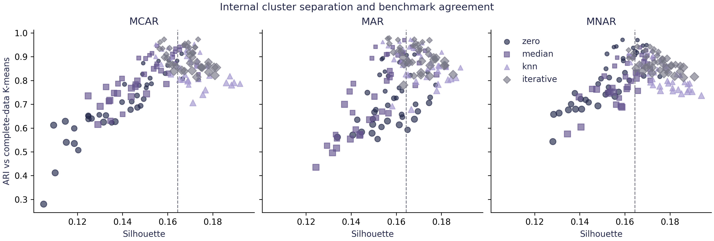
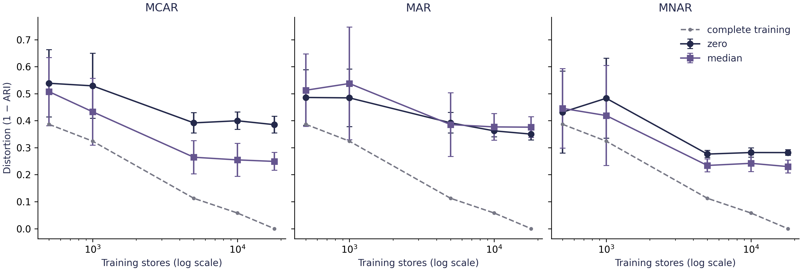

# Beyond Data Volume

## Evaluating Clustering Robustness Under Missing-Data Mechanisms

A synthetic study of convenience-store segmentation. It examines when
missing sales and the assumptions used to fill them can alter store
assignments even as a clustering model reports stronger internal separation.

## Expanded study and interactive publication

[Live research site](https://minseok2626.github.io/Missing-Data-Clustering-Robustness/) · [Expanded report](reports/expanded_report.md) · [PDF](reports/expanded_report.pdf) · [Expanded results](results/expanded) · [Data dictionary](data/expanded.md)

The expanded primary factorial completed **4,800 usable fits across 80
synthetic cohorts and 60 configurations**. The design retains the first
eight original seeds and adds seeds 1001–1072. The public site exposes
seed-level data, distribution summaries, matched comparisons, masking
demonstrations and representative store profiles. Original results and
figures remain in `results/tables/` and `results/figures/`. The sample-size
experiment and observation-level uncertainty analysis rely on those
original cohorts. The findings below document that original study.

From the repository root, after installing the pinned dependencies:

```bash
python -m pytest -q
python run_expanded.py --jobs 4
python -m scripts.analyze_expanded
python -m scripts.write_report
pandoc reports/expanded_report.md --pdf-engine=xelatex -o reports/expanded_report.pdf
python -m scripts.build_site
python -m http.server 8000 --directory _site
```

`run_expanded.py` writes an atomic checkpoint per completed seed under
`.checkpoints/expanded/`. Rerun the same command to continue. Use a fresh
checkpoint directory with any change of design, source implementation or
numerical environment. Each process has one numerical thread. Worker errors
leave their seeds available for retry. Use `--collect-only --output /path/to/review` to assemble completed checkpoints without starting pending seeds. Failed configurations within complete
seed checkpoints remain in the diagnostic ledger. The report and interactive
figures regenerate from the same seed-level source. Use
`python run_experiments.py --config configs/default.yaml` to regenerate original
PNG and SVG figures, and `python -m scripts.build_site --original --output _site_original`
to build against the original factorial.

| Path | Contents |
| --- | --- |
| `src/` | Simulation, preprocessing, model evaluation and statistical estimation |
| `configs/` | Original, quick and expanded designs |
| `results/` | Original outputs and expanded run ledger, summaries and contrasts |
| `scripts/` | Statistical analysis, report generation and static site assembly |
| `site/` | Browser interface for the precomputed experiments |
| `reports/` and `notebooks/` | Research write-ups and original walkthroughs |

Browser smoke tests use the Node Playwright package and Chromium. With the
assembled site served locally, use `node scripts/check_site.cjs`.
Set `BDV_SITE_URL` to exercise a repository subpath and
`BDV_SCREENSHOTS` to capture screenshots.

## Motivation and research questions

An internship project used K-means to segment stores from transaction records.
Zero filling was convenient because stores offered different products, but a
missing sales record and a recorded zero carry different information. This
study tests that distinction with entirely synthetic data.

1. How do MCAR, MAR and MNAR affect agreement with a complete-data segmentation?
2. How do zero, median, KNN and iterative imputation alter clusters and individual assignments?
3. Can silhouette improve while agreement with the complete-data benchmark falls?
4. Does increasing sample size mitigate distortion when missingness persists?
5. What do cross-scenario stability and mixture posteriors reveal about stores that may need review?

## Design

The generator creates four overlapping store profiles with ten related features,
including traffic, transaction value, sales by product, and weekend and evening
customer shares. Some stores genuinely do not carry a product and have recorded
zeros. Only product sales are exposed to probabilistic masking. Latent
profiles are stored separately and used for evaluation.

The original factorial experiment uses eight seeds, 5,000 stores per seed,
five target product-cell masking rates from 5% to 40%, three mechanisms and
four imputation methods. Four-cluster K-means is compared with seed-matched
complete-data K-means. An additional held-out study varies training size from
500 to 18,000, while mixture posteriors and repeated masking quantify different
aspects of store-level uncertainty. MNAR sensitivity refits the clustering
after shifting the iterative estimates for missing cells.

[Methodology](reports/methodology.md) · [Research report](reports/research_report.md) · [Result tables](results/tables) · [Figures](results/figures)

## Findings

- At 30% MCAR masking, mean benchmark ARI was 0.632 with zero fill, 0.751
  with median fill and 0.861 with iterative imputation. Zero fill had the
  highest masked-cell RMSE in 13 of 15 mechanism–rate combinations, yet
  gave the highest mean ARI at 5% MNAR. Reconstruction and segmentation
  rankings can differ. [Factorial summary](results/tables/factorial_summary.csv)
- In one 40% MAR run with KNN, silhouette rose from 0.160 to 0.167 while
  benchmark ARI was 0.678 and 13.5% of stores changed aligned assignments.
  No run with silhouette at or above its benchmark had ARI below 0.50.
  [Seed-level results](results/tables/factorial.csv)
- Under 30% MNAR with zero fill, growing the training set from 500 to 18,000
  raised mean held-out ARI from 0.568 to 0.718 and lowered its across-seed SD
  from 0.152 to 0.010. Disagreement remained at the largest size.
  [Sample-size summary](results/tables/sample_size_summary.csv)
- In the 5,000-store uncertainty cohort, 183 stores had a maximum mixture
  posterior of at least 0.80 but cross-scenario stability below 0.60.
  [Store-level results](results/tables/store_stability.csv)



Each point is one run. Larger points indicate higher masking targets.
The dashed line shows mean complete-data silhouette across seeds.



Error bars show one across-seed standard deviation.

## Business implications

The analysis illustrates a three-way allocation of effort. Stores with stable
assignments and concentrated mixture memberships may be candidates for
cluster-level assortment or inventory strategies. Intermediate cases may
benefit from managerial review. Unstable cases may warrant better data or
individual assessment before standardizing promotions. The thresholds are
illustrative and the simulation does not estimate operational outcomes.

## Statistical limitations

All results are conditional on one generator, the chosen masking functions,
and a handful of modeling choices. Complete-data K-means is a reference
partition. The latent profiles overlap and represent a different target.
A Gaussian mixture posterior describes uncertainty within a fitted model.
The MNAR shifts explore plausible assumptions without identifying the missing
values or mechanisms from observations. The sample-size analysis is inspired
by Meng's discussion of data quantity and data quality and does not replicate
his theoretical results.

## Reproduce

Validated on Python 3.12.14. From the repository root:

```bash
python3.12 -m venv .venv
source .venv/bin/activate
python -m pip install -r requirements.txt
python -m pytest -q
python run_experiments.py --config configs/quick.yaml
python run_experiments.py --config configs/default.yaml
```

Quick mode writes to `quick-results/` and uses two seeds and smaller cohorts.
Full mode writes to `results/`, including the configuration and version
manifest, raw and grouped CSVs, a representative synthetic cohort, and 300-DPI
PNG and SVG figures. Use `--output /path/to/directory` for a clean rerun.
The notebooks read the generated outputs and can be opened from the repository
root with `jupyter notebook`. The runner limits numerical kernels to one
thread to keep memory use predictable during KNN and silhouette calculations.

## References

- Meng, X.-L. (2018). Statistical paradises and paradoxes in big data (I). Law of large populations, big data paradox, and the 2016 US presidential election. *Annals of Applied Statistics*, 12(2), 685–726. [DOI](https://doi.org/10.1214/18-AOAS1161SF)
- Rubin, D. B. (1976). Inference and missing data. *Biometrika*, 63(3), 581–592. [DOI](https://doi.org/10.1093/biomet/63.3.581)
- Rousseeuw, P. J. (1987). Silhouettes. A graphical aid to the interpretation and validation of cluster analysis. *Journal of Computational and Applied Mathematics*, 20, 53–65. [DOI](https://doi.org/10.1016/0377-0427(87)90125-7)
